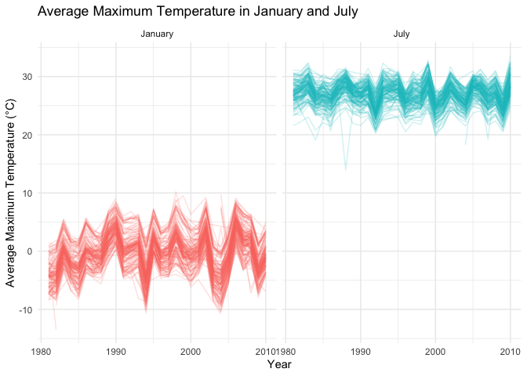
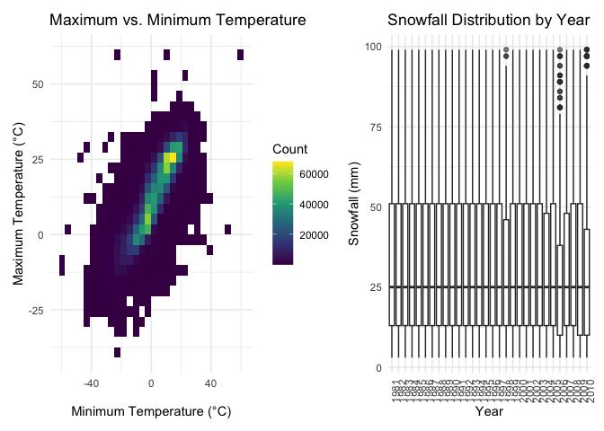
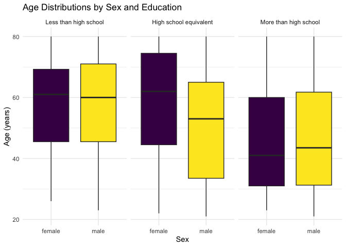
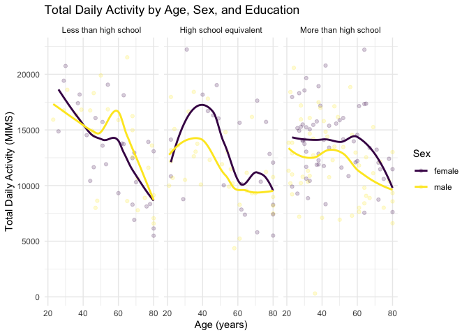
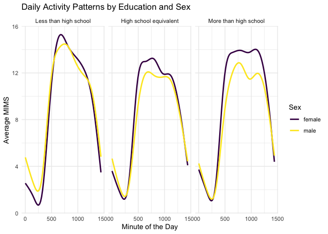
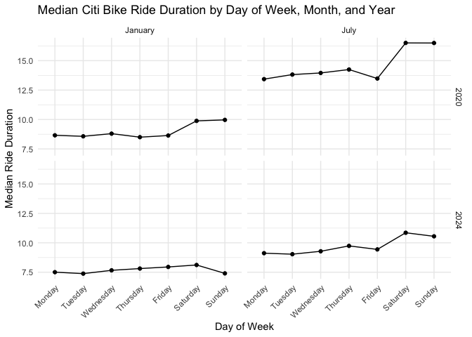
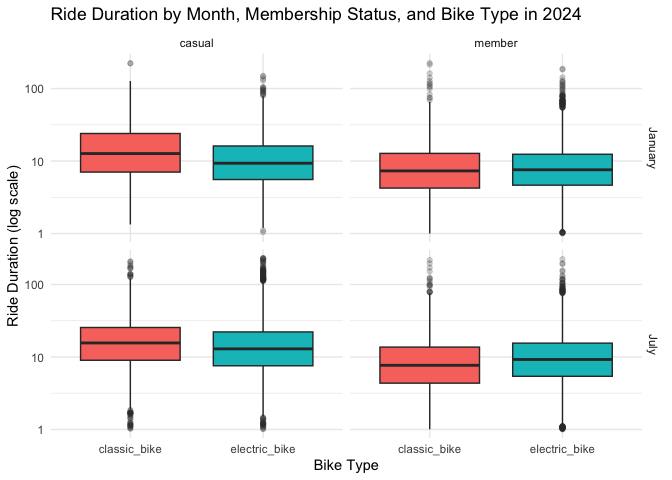

p8105_hw3_mts2203
================
Madeline Sharp
2026-10-17

# Problem 0

## Loading All Libraries

``` r
# loading tidyverse library
library(tidyverse)

# loading p8105.datasets library
library(p8105.datasets)

# loading patchwork library
library(patchwork)
```

# Problem 1

## Reading ny_noaa Dataset

``` r
# reading ny_noaa data
data("ny_noaa")
```

## Short Description of the ny_noaa Dataset

The `ny_noaa` has 2595176 rows and 7 columns. Its key (column) variables
include id, date, prcp, snow, snwd, tmax, tmin. The variables have the
following data types, respectively: character, Date, integer, integer,
integer, character, character. As for what each variable represents:
`id` gives the weather station ID, `date` gives the date of observation,
`prcp` gives precipitation in tenths of mm, `snow` gives snowfall in mm,
`snwd` gives snow depth in mm, `tmax` gives maximum temperature in
tenths of degrees C, and `tmin` gives minimum temperature in tenths of
degrees C. The proportion of missing values in each column is
approximately as follows: 0%, 0%, 5.62%, 14.69%, 22.8%, 43.71%, 43.71%.
To clean the data, the missing values should be standardized to `NA`.

## Cleaning ny_noaa Data

``` r
# creating, cleaning and standardizing values in ny_noaa_df
ny_noaa_df =
  ny_noaa |>
  separate(date, into = c("year", "month", "day"), sep = "-") |>
mutate(
    tmax = as.numeric(tmax) / 10,
    tmin = as.numeric(tmin) / 10,
    prcp = as.numeric(prcp) / 10
  )

# counting the most commonly observed values for snowfall
ny_noaa_df |>
  count(snow, sort = TRUE) |>
  head(10)
```

    ## # A tibble: 10 × 2
    ##     snow       n
    ##    <int>   <int>
    ##  1     0 2008508
    ##  2    NA  381221
    ##  3    25   31022
    ##  4    13   23095
    ##  5    51   18274
    ##  6    76   10173
    ##  7     8    9962
    ##  8     5    9748
    ##  9    38    9197
    ## 10     3    8790

## Interpretating the Cleaned ny_noaa Data

In the `ny_noaa_df`, 0mm is the most commonly observed value because it
does not snow throughout most of the year in New York.

## Plotting Avg. Max Temp. in January and in July in each Station over Years

``` r
#  calculating average maximum temperature for each station, year, and month
avg_max_temp =
  ny_noaa_df |>
  mutate(
    year = as.numeric(year),
    month = as.numeric(month)
  ) |>
  filter(month %in% c(1, 7)) |>
  group_by(id, year, month) |>
  summarize(
    mean_tmax = mean(tmax, na.rm = TRUE),
    .groups = "drop"
  ) |>
  filter(is.finite(mean_tmax))

# creating a two-panel plot comparing January and July temperatures
avg_max_temp |>
  mutate(
    month = factor(
      month,
      levels = c(1, 7),
      labels = c("January", "July")
    )
  ) |>
  ggplot(aes(
    x = year,
    y = mean_tmax,
    group = id,
    color = month
  )) +
  geom_line(alpha = 0.2) +
  facet_grid(. ~ month) +
  labs(
    title = "Average Maximum Temperature in January and July",
    x = "Year",
    y = "Average Maximum Temperature (°C)",
    color = "Month"
  ) +
  theme_minimal() +
  theme(legend.position = "none")
```

<!-- -->

## Comments on Structure and Outliers

Yes, there is an observable/interpretable structure. The July maximum
average temperatures are consistently higher than the January ones. The
is a pattern that is seasonally expected. Temperatures also vary across
stations and years, though, there is a visible overall pattern to the
data across time in each plot. There are some potential outliers in each
where some stations appear to be experiencing unusually high or low
average maximum temperatures relative to the general set.

``` r
# plotting tmax vs tmin for the full dataset
temp_range_plot =
  ny_noaa_df |>
  ggplot(aes(x = tmin, y = tmax)) +
  geom_bin2d(na.rm = TRUE) +
  scale_fill_viridis_c() +
  labs(
    title = "Maximum vs. Minimum Temperature",
    x = "Minimum Temperature (°C)",
    y = "Maximum Temperature (°C)",
    fill = "Count"
  ) +
  theme_minimal()

# plotting distribution of snowfall values > 0 and <100 separately by year
snowfall_range_plot =
  ny_noaa_df |>
  mutate(year = as.numeric(year)) |>
  filter(snow > 0, snow < 100) |>
  ggplot(aes(x = factor(year), y = snow)) +
  geom_boxplot(outlier.alpha = 0.2) +
  labs(
    title = "Snowfall Distribution by Year",
    x = "Year",
    y = "Snowfall (mm)"
  ) +
  theme_minimal() +
  theme(axis.text.x = element_text(angle = 90, hjust = 1))

# combining into a two-panel plot
temp_range_plot + snowfall_range_plot
```

<!-- -->

# Problem 2

## Reading, Cleaning and Merging the Accelerometer datasets

``` r
# reading and cleaning nhanes_accel.csv data
nhanes_accel_df = 
  read_csv(
    file = paste0(
      "p8105_hw3_mts2203_files/",
      "nhanes_accel.csv"), 
    na = c("", "NA", ".")
    ) |>
  janitor::clean_names() |>
  pivot_longer(
    cols = starts_with("min"),
    names_to = "minute",
    values_to = "mims"
  ) |>
  mutate(
    minute = as.numeric(str_remove(minute, "min")),
    seqn = as.character(seqn)
  )

# reading and cleaning nhanes_covar.csv data
nhanes_covar_df =
  read_csv(
    file = "p8105_hw3_mts2203_files/nhanes_covar.csv",
    na = c("", "NA", "."),
    skip = 4
  ) |>
  janitor::clean_names() |>
  mutate(
    sex = case_match(
      sex,
      1 ~ "male",
      2 ~ "female"
    ),
    education = case_match(
      education,
      1 ~ "Less than high school",
      2 ~ "High school equivalent",
      3 ~ "More than high school"
    )
  ) |>
  mutate(
    sex = factor(sex),
    education = factor(
      education,
      levels = c(
        "Less than high school",
        "High school equivalent",
        "More than high school"
      ),
      ordered = TRUE
    )
  ) |>
  mutate(
    seqn = as.character(seqn)
  ) |>
  filter(age >= 21) |>
  drop_na()
```

    ## Warning: There was 1 warning in `mutate()`.
    ## ℹ In argument: `sex = case_match(sex, 1 ~ "male", 2 ~ "female")`.
    ## Caused by warning:
    ## ! `case_match()` was deprecated in dplyr 1.2.0.
    ## ℹ Please use `recode_values()` instead.

``` r
# merging the two datasets
nhanes_df =
  inner_join(nhanes_accel_df, nhanes_covar_df, by = "seqn")
```

``` r
# producing a reader-friendly table for no. of men & women by education category
nhanes_df |>
  distinct(seqn, education, sex) |>
  count(education, sex) |>
  pivot_wider(
    names_from = sex,
    values_from = n
  ) |>
  knitr::kable(
    col.names = c("Education", "Men", "Women"),
    caption = "Number of Participants by Education and Sex"
  )
```

| Education              | Men | Women |
|:-----------------------|----:|------:|
| Less than high school  |  28 |    27 |
| High school equivalent |  23 |    35 |
| More than high school  |  59 |    56 |

Number of Participants by Education and Sex

``` r
# visualizing age distributions for men and women by education category
nhanes_df |>
  distinct(seqn, age, sex, education) |>
  ggplot(aes(x = sex, y = age, fill = sex)) +
  geom_boxplot() +
  facet_grid(.~ education) +
  labs(
    title = "Age Distributions by Sex and Education",
    x = "Sex",
    y = "Age (years)",
    fill = "Sex"
  ) +
  theme_minimal() +
  theme(legend.position = "none")
```

<!-- -->

## Commenting on Table and Plot

Both the table and the plot provide more substantial visualizations of
how the number of men and women varies in each education category. As
per the table, for women, the numbers increase as the education level
increases. Whereas for men, this was not that case. While a “more than
high school” education was the most common single category among men,
the “less than high school” category was the second most common. That
said, the number of men in the “more than high school” catgeory were
more than twice those in the other two categories combined. Looking at
the boxplot, when you add age into the mix, as education level increased
for men, the reported age range captured tended to decrease. This was
not the case for the women, where the oldest ages captured where in the
“high school equivalent” category, followed by the “less than high
school” and “more than high school” categories.

``` r
# plotting total activities against age using the total_activity variable
nhanes_df |>
  group_by(seqn, age, sex, education) |>
  summarize(
    total_activity = sum(mims, na.rm = TRUE),
    .groups = "drop"
  ) |>
  ggplot(aes(x = age, y = total_activity, color = sex)) +
  geom_point(alpha = 0.2) +
  geom_smooth(se = FALSE) +
  facet_grid(.~ education) +
   viridis::scale_color_viridis(discrete = TRUE) +
  labs(
    title = "Total Daily Activity by Age, Sex, and Education",
    x = "Age (years)",
    y = "Total Daily Activity (MIMS)",
    color = "Sex"
  ) +
  theme_minimal()
```

<!-- -->

## Commenting on Total Daily Activity Plot

Within each level of education, the sex distributions related to total
daily activity mimics one another in shape. Although, the are not
exactly the same, with men genererally being less active than women in
all except the “less than high school” category as an overall trend as
age increases. The “less than high school” category starts with the
highest daily activity level for both sexes and has the sharpest decline
over age, although activity briefly picks back up for both sexes at
around age 60. The “high school equivalent” category has activity rising
with age until late 30s and early 40s before dropping off, with a brief
rise again for women that begins in the 60s and ends around 70. For men
in this cateory, exercise reaches its lowest point close to 60 and
plateaus through to 80. The “more than high school” plot shows exercise
plateauing for men and women in their 20s through to their 50s, with
slight variations for men. In this category, exercise peaks for women at
60 before dropping steeply until age 80. Whereas for men activity begins
dropping in their 40s. Generally, activity decreases as age decreases.

``` r
# making a three-panel plot of 24-hour activity time courses by education level 
nhanes_df |>
  group_by(seqn, minute, sex, education) |>
  summarize(
    mims = mean(mims, na.rm = TRUE),
    .groups = "drop"
  ) |>
  group_by(minute, sex, education) |>
  summarize(
    mean_mims = mean(mims, na.rm = TRUE),
    .groups = "drop"
  ) |>
  ggplot(aes(x = minute, y = mean_mims, color = sex)) +
  geom_smooth(se = FALSE) +
  facet_grid(.~ education) +
  viridis::scale_color_viridis(discrete = TRUE) +
  labs(
    title = "Daily Activity Patterns by Education and Sex",
    x = "Minute of the Day",
    y = "Average MIMS",
    color = "Sex"
  ) +
  theme_minimal()
```

<!-- -->

## Commenting on 24-hour Activity Time Courses by Education Level Plot

The general shapes of sex per minute of the day within a 24-hour period
is similar across plots, with activity rising until around midday and
dropping off at the end of day. However, women match or outpace men in
activity throughout the day across categories. That said, for “less than
high school” activity levels peaks close to midday for both sexes befor
noticeably decreasing, whereas for the other categories activity
plateaus in the late morning and afternoon before starkly decreasing as
end-of-day approaches. Across all categories activity is at its absolute
lowest around 250 minutes into, (or around 4-4:10am in), the morning.

# Problem 3

## Importing, Cleaning, Tidying and Describing the NYC Citi Bike Final Dataset

``` r
# reading and cleaning the January 2020 dataset
nyc_citi_bike_jan_2020 =
  read_csv("p8105_hw3_mts2203_files/citibike/Jan 2020 Citi.csv") |>
  mutate(month = "January", 
         year = 2020)

# reading and cleaning the January 2024 dataset
nyc_citi_bike_jan_2024 =
  read_csv("p8105_hw3_mts2203_files/citibike/Jan 2024 Citi.csv") |>
  mutate(month = "January", 
         year = 2024)

# reading and cleaning the July 2020 dataset
nyc_citi_bike_july_2020 =
  read_csv("p8105_hw3_mts2203_files/citibike/July 2020 Citi.csv") |>
  mutate(month = "July", 
         year = 2020)

# reading and cleaning the July 2024 dataset
nyc_citi_bike_july_2024 =
  read_csv("p8105_hw3_mts2203_files/citibike/July 2024 Citi.csv") |>
  mutate(month = "July", 
         year = 2024)

# combining all NYC Citi Bike datasets
nyc_citi_bike_df =
  bind_rows(
    nyc_citi_bike_jan_2020,
    nyc_citi_bike_jan_2024,
    nyc_citi_bike_july_2020,
    nyc_citi_bike_july_2024
  ) |>
  janitor::clean_names() |>
  mutate(
    month = factor(month, levels = c("January", "July")),
    year = as.integer(year)
  )
```

## Short Description of the Resulting Dataset

The `nyc_citi_bike_df` has 99485 rows and 9 columns. Its key (column)
variables include ride_id, rideable_type, weekdays, duration,
start_station_name, end_station_name, member_casual, month, year. The
variables have the following data types, respectively: character,
character, character, numeric, character, character, character, factor,
integer.

## Producing a Reader-friendly Table of Rides per Year, Month and Rider Type

``` r
# producing a reader-friendly table of rides per year, month, and rider type
nyc_citi_bike_reader_friendly_df = 
  nyc_citi_bike_df |>
  count(year, month, member_casual) |>
  pivot_wider(
    names_from = member_casual,
    values_from = n
  ) |>
  arrange(year, month) |>
  knitr::kable(
    col.names = c("Year", "Month", "Casual Riders", "Members"),
    caption = "Total Citi Bike Rides by Year, Month, and Rider Type"
  )
```

## Commenting on the Table of Rides per Year, Month and Rider Type

The reader-friendly `nyc_citi_bike_reader_friendly_df` table has rows
and columns. Its key (column) variables include . The variables have the
following data types, respectively: character, character, character,
character, character, character, character, character. July 2024 has the
largest number of both casual riders and Citi Bike members. Generally,
July has higher numbers than January. This is likely because people ride
more Citi Bikes in the summer than in the winter. The summer is also
likely a higher tourist season, which would also boost the number of
casual riders. The COVID-19 pandemic may be accounting for the much
lower summer numbers in 2020, than in 2024. Members vastly outpace
casual riders in all months.

## Making a Table Showing the 5 Most Popular Starting Stations for July 2024

``` r
# making a table of the 5 most popular starting stations for July 2024
nyc_citi_bike_df |>
  filter(year == 2024, month == "July") |>
  count(start_station_name, sort = TRUE) |>
  head(5) |>
  knitr::kable(
    col.names = c("Starting Station", "Number of Rides"),
    caption = "Top 5 Most Popular Citi Bike Starting Stations, July 2024",
    format.args = list(big.mark = ","),
    align = "c"
  )
```

|     Starting Station     | Number of Rides |
|:------------------------:|:---------------:|
| Pier 61 at Chelsea Piers |       163       |
| University Pl & E 14 St  |       155       |
|     W 21 St & 6 Ave      |       152       |
|  West St & Chambers St   |       150       |
|     W 31 St & 7 Ave      |       146       |

Top 5 Most Popular Citi Bike Starting Stations, July 2024

## Making a Plot to Investigate Timespan’s Effects on Median Ride Duration

``` r
# plotting the median ride duration by day of week, month, and year
nyc_citi_bike_df |>
  group_by(year, month, weekdays) |>
  summarize(
    median_duration = median(duration, na.rm = TRUE),
    .groups = "drop"
  ) |>
  ggplot(
    aes(x = weekdays, y = median_duration, group = 1)
  ) +
  geom_line() +
  geom_point() +
  facet_grid(rows = vars(year), cols = vars(month)) +
  labs(
    title = "Median Citi Bike Ride Duration by Day of Week, Month, and Year",
    x = "Day of Week",
    y = "Median Ride Duration"
  ) +
  theme_minimal()
```

<!-- -->

## Commenting on Observations about Median Ride Duration by Timespan Plot

The `nyc_citi_bike_df` plot shows that weekend ride duration is
generally higher on average and July ride duration is higher than
average, and 2020 ride duration is generally higher on average. Higher
ride duration in July might reflect seasonal differences. Altogether,
the highest ride duration is on weekends in July 2020.

## Making Figure of Month, Membership Status, and Bike Type on Ride Duration

``` r
# plotting figure of month, membership status, and bike type on ride duration
nyc_citi_bike_df |>
  filter(year == 2024, duration > 0) |>
  ggplot(aes(x = rideable_type, y = duration, fill = rideable_type)) +
  geom_boxplot(outlier.alpha = 0.2) +
  facet_grid(rows = vars(month), cols = vars(member_casual)) +
  scale_y_log10() +
  labs(
    title = "Ride Duration by Month, Membership Status, and Bike Type in 2024",
    x = "Bike Type",
    y = "Ride Duration (log scale)"
  ) +
  theme_minimal() +
  theme(
    legend.position = "none"
  )
```

<!-- -->

## Commenting on Ride Duration Figure

The `nyc_citi_bike_df` figure depicting month, membership status, and
bike type on ride duration provides results that are fairly similar
regarding of month, membership status, and bike type relative to ride
duration. The slight difference exists in that for casual riders
`classic_bike` riding duration is slightly longer than `electric_bike`
regardless of month. Also, generally casual riders ride either bike type
slightly longer than members do. For members, the median value of
`classic_bike` is especially close to `electric_bike` duration, with
`electric_bike` ride duration being slightly higher than `classic_bike`
duration in July.
